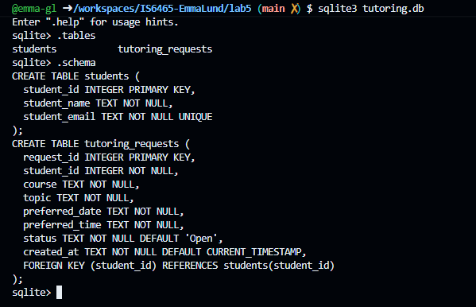
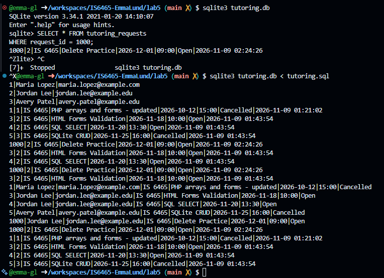

## Part 1

1. A screenshot or pasted output showing both table names and the table schema:

    

2. Which column is the primary key in each table? 

    The primary key in `students` is `student_id`. The primary key in `tutoring_requests` is `request_id`.


3. Which column is the foreign key, and what relationship does it represent?

    `tutoring_requests.student_id` is the foreign key which references `students.student_id`. It represents the relationship between each tutoring request and the student it belongs to.

4. Why is student_email marked UNIQUE? 

    `student_email` is `UNIQUE` so the same email cannot be used for multiple student records, so there are no duplicates.

## Part 2

1. The INSERT statements you used or a screenshot of them in lab5.sql:

   ```sql
   INSERT OR IGNORE INTO students (student_name, student_email)
   VALUES
     ('Jordan Lee', 'jordan.lee@example.edu'),
     ('Avery Patel', 'avery.patel@example.edu');

   INSERT INTO tutoring_requests
     (student_id, course, topic, preferred_date, preferred_time)
   SELECT student_id, 'IS 6465', 'Forms', '2026-11-18', '10:00'
   FROM students
   WHERE student_email = 'jordan.lee@example.edu'
     AND NOT EXISTS (
       SELECT 1 FROM tutoring_requests
       WHERE student_id = students.student_id
         AND course = 'IS 6465' AND topic = 'Forms'
         AND preferred_date = '2026-11-18' AND preferred_time = '10:00'
     );

   INSERT INTO tutoring_requests
     (student_id, course, topic, preferred_date, preferred_time)
   SELECT student_id, 'IS 6465', 'SQL SELECT', '2026-11-20', '13:30'
   FROM students
   WHERE student_email = 'jordan.lee@example.edu'
     AND NOT EXISTS (
       SELECT 1 FROM tutoring_requests
       WHERE student_id = students.student_id
         AND course = 'IS 6465' AND topic = 'SQL SELECT'
         AND preferred_date = '2026-11-20' AND preferred_time = '13:30'
     );

   INSERT INTO tutoring_requests
     (student_id, course, topic, preferred_date, preferred_time)
   SELECT student_id, 'IS 6465', 'SQLite CRUD', '2026-11-25', '16:00'
   FROM students
   WHERE student_email = 'avery.patel@example.edu'
     AND NOT EXISTS (
       SELECT 1 FROM tutoring_requests
       WHERE student_id = students.student_id
         AND course = 'IS 6465' AND topic = 'SQLite CRUD'
         AND preferred_date = '2026-11-25' AND preferred_time = '16:00'
     );
   ```

2. A screenshot or pasted SELECT * output that shows the rows in both tables.:

    ```text
    sqlite> SELECT * FROM students ORDER BY student_id;
    1|Maria Lopez|maria.lopez@example.com
    2|Jordan Lee|jordan.lee@example.edu
    3|Avery Patel|avery.patel@example.edu
    sqlite> SELECT * FROM tutoring_requests ORDER BY request_id;
    1|1|IS 6465|PHP arrays and forms - updated|2026-10-12|15:00|Cancelled|2026-11-09 01:21:02
    3|2|IS 6465|Forms|2026-11-18|10:00|Open|2026-11-09 01:43:54
    4|2|IS 6465|SQL SELECT|2026-11-20|13:30|Open|2026-11-09 01:43:54
    5|3|IS 6465|SQLite CRUD|2026-11-25|16:00|Open|2026-11-09 01:43:54
    ```

3. An explanation of why Jordan has one student row but two request rows:

    Jordan has one row in `students` because that table stores each student's details once. Both of Jordan's tutoring requests reference the same `student_id` in `tutoring_requests`, so there's able to be more than one request row.

## Part 3
```sql
SELECT
  r.request_id,
  s.student_name,
  s.student_email,
  r.course,
  r.topic,
  r.preferred_date,
  r.preferred_time,
  r.status
FROM tutoring_requests AS r
JOIN students AS s ON r.student_id = s.student_id
ORDER BY r.preferred_date;
```

```text
1|Maria Lopez|maria.lopez@example.com|IS 6465|PHP arrays and forms - updated|2026-10-12|15:00|Cancelled
3|Jordan Lee|jordan.lee@example.edu|IS 6465|Forms|2026-11-18|10:00|Open
4|Jordan Lee|jordan.lee@example.edu|IS 6465|SQL SELECT|2026-11-20|13:30|Open
5|Avery Patel|avery.patel@example.edu|IS 6465|SQLite CRUD|2026-11-25|16:00|Open
```

1. What does the JOIN condition connect?

    The `JOIN` condition connects `tutoring_requests.student_id` with `students.student_id`, associating each request with the student who made it.

2. What is the difference between the purpose of JOIN and WHERE?

    `JOIN` combines related rows from tables; `WHERE` filters the resulting rows to those matching a condition.

3. Why should the application retrieve one request by request_id instead of by topic alone?

    `request_id` uniquely identifies a request. A topic can occur in multiple requests, so looking up by topic alone could return the wrong request or multiple requests.

## Part 4
1. The two UPDATE statements you used:

   ```sql
   UPDATE tutoring_requests
   SET topic = 'HTML Forms Validation'
   WHERE request_id = 3;

   UPDATE tutoring_requests
   SET status = 'Cancelled'
   WHERE request_id = 5;
   ```

2. A before-and-after screenshot or pasted SELECT output for the revised request:

   ```text
   Before:
   3|Jordan Lee|jordan.lee@example.edu|IS 6465|Forms|2026-11-18|10:00|Open

   After:
   3|Jordan Lee|jordan.lee@example.edu|IS 6465|HTML Forms Validation|2026-11-18|10:00|Open
   ```

3. A screenshot or pasted query result showing Avery's Cancelled status:
   ```text
   5|Avery Patel|avery.patel@example.edu|IS 6465|SQLite CRUD|2026-11-25|16:00|Cancelled
   ```

4. Why is a specific WHERE clause essential in an UPDATE statement?

    A specific `WHERE` clause is essential because it limits the update to the intended row. Without it, an `UPDATE` changes every row in the table.

5. Why does the Peer Tutoring Hub use a Cancelled status instead of immediately deleting a real request?

    Marking a real request `Cancelled` preserves its record and history, while deleting it would permanently remove that information.

## Part 5

1. The INSERT statement for the test request:

   ```sql
   INSERT OR IGNORE INTO tutoring_requests
     (request_id, student_id, course, topic, preferred_date, preferred_time)
   VALUES
     (1000, 2, 'IS 6465', 'Delete Practice', '2026-12-01', '09:00');
   ```

2. The DELETE statement you used:

   ```sql
   DELETE FROM tutoring_requests
   WHERE request_id = 1000;
   ```

3. A screenshot or pasted output that verifies the test record was removed:

    

4. Why is a WHERE clause essential in a DELETE statement? 

    A `WHERE` clause restricts deletion to the intended row. Without it, `DELETE` removes every row from the table.

## Part 6

| CRUD action | SQL statement used in this lab | Peer Tutoring Hub example |
|---|---|---|
| Create | `INSERT INTO tutoring_requests (student_id, course, topic, preferred_date, preferred_time) ...` | Save a student's new tutoring request with its course, topic, preferred date, preferred time, and student ID. |
| Read | `SELECT ... FROM tutoring_requests AS r JOIN students AS s ON r.student_id = s.student_id ...` | Display requests alongside the name and email of each student. |
| Update | `UPDATE tutoring_requests SET topic = 'HTML Forms Validation' WHERE request_id = 3;` | Change the topic for one existing request. |
| Delete | `DELETE FROM tutoring_requests WHERE request_id = 1000;` | Remove the temporary `Delete Practice` test request. |

1. How does the database preserve the connection between a student and that student's requests?
   The `student_id` foreign key in `tutoring_requests` references `students.student_id` to link each request to its designated student and vice versa.

2. Which database constraint prevents two student rows from using the same email address?
   The `UNIQUE` constraint on `students.student_email`

3. What could happen if an UPDATE or DELETE statement did not include a WHERE clause?
   It could modify or delete every row in the table instead of just the intended record.

4. When the application later receives values from an HTML form, why should PHP send those values as parameters instead of placing them directly into SQL text?
   Parameterized queries keep user-provided values separate from SQL code, which prevents SQL injection and correctly handling values that contain special characters.
