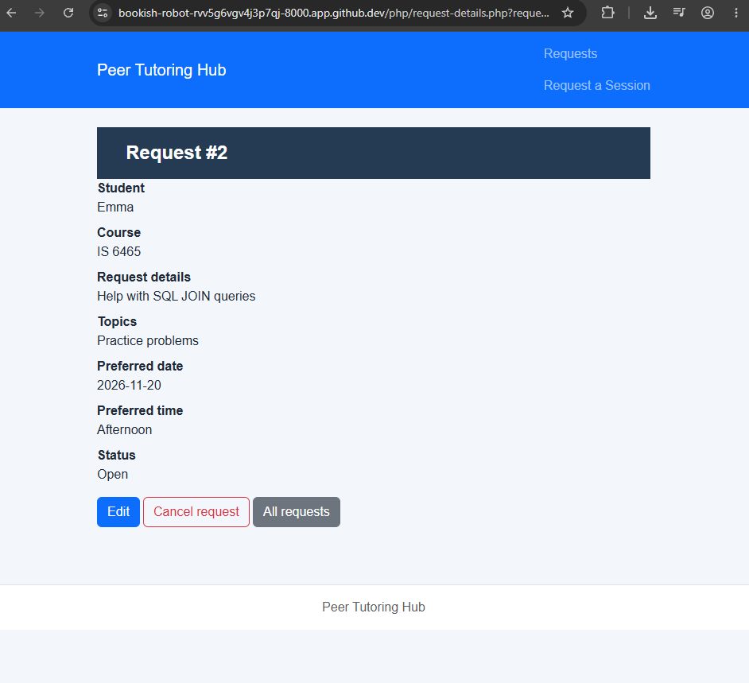

# Lab 6 Notes – Peer Tutoring Hub

## Part 1


```bash
sqlite3 database/tutoring.db < database/setup-database.sql

$ sqlite3 database/tutoring.db
sqlite> .tables
students           tutoring_requests
```

## Part 2

1. https://bookish-robot-rvv5g6vgv4j3p7qj-8000.app.github.dev/php/request-form.php

2. After I clicked 'Request session', the app redirected to /php/request-details.php?request_id=2`. The detail page showed all of the values I submitted status Open, so the request was saved to SQLite and displayed.

3. 


## Part 3

| Test | What I Did | Expected Result | Actual Result | Pass or Fail |
|---|---|---|---|---|
| Submit a valid request | Filled out the form with the test data above and clicked 'Request Session'. | A new tutoring request is created with status Open. | Redirected to Request #2. The detail page showed my values and Status: Open. | Pass |
| View all requests | Clicked 'All Requests'/Opened `/php/requests.php`. | The new request appears in the request list. | The list showed request 2 above request 1 (Maria Lopez). | Pass |
| Filter requests | Filtered Course = IS 6495, then Status = Cancelled (before cancelling anything). | Filtering by course or status shows matching requests. | The IS 6495 filter showed only request 2. The Cancelled filter showed "No matching requests." | Pass |
| Edit an Open request | On Request #2, clicked 'Edit'. Changed course to IS 6495 and  clicked Save changes. | The revised values are displayed. | Redirected back to the detail page, which showed all of the revised values | Pass |
| Cancel an Open request | Created a new request and clicked Cancel after I was redirected. | The request status changes to Cancelled. | The detail page showed Status: Cancelled. | Pass |
| Try to edit or cancel a cancelled request | Went to `/php/edit-request.php?request_id=3` and `/php/delete-request.php?request_id=3` by URL, since the buttons are hidden. | The application does not allow the change. | The edit page showed "Only Open requests may be edited." and the cancel page showed "Only Open requests can be cancelled." with no button. | Pass |

## Part 4

1. **Which file displays the tutoring request form?**
   php/request-form.php``method="post".

2. **Which file receives the submitted form data?**
   php/process-request.php

3. **Which file opens the PDO connection to SQLite?**
   config/db.php

4. **Which file coordinates validation and the database transaction?**
   services/requestService.php

5. **Which files contain the SQL statements?**
   repositories/studentPDO.php

6. **Which table stores student information?**
   students (student_id, student_name, student_email)

7. **Which table stores tutoring requests?**
   tutoring_requests 

8. **How does a tutoring request connect to the student who submitted it?**
   Through the foreign key (tutoring_requests.student_id), which references students.student_id

Why SQL belongs in repository files:
SQL statements should go in repository files to keep the form page clean and easier to understand. It also makes the code easier to manage because you can update or reuse SQL queries without having to change the form itself. Keeping them separate helps keep everything organized and makes fixing problems a lot easier.

## Part 5
Original output:
```text
PASS UC01 create and Open
PASS Lab 4 checkbox values preserved
FAIL Duplicate email reuses student
FAIL UC02 course and status filter
PASS Invalid reason rejected
FAIL Invalid submission writes nothing
PASS Edit Open request
PASS Updated reason persisted
PASS Cancel Open request
PASS Cancelled row retained
PASS Second cancellation rejected
PASS Unrelated request unchanged
PASS FK enforced
PASS UC02 empty filter result
FAILURES: 3
```
Output after changes: 
```
PASS UC01 create and Open
PASS Lab 4 checkbox values preserved
PASS Duplicate email reuses student
PASS UC02 course and status filter
PASS Invalid reason rejected
PASS Invalid submission writes nothing
PASS Edit Open request
PASS Updated reason persisted
PASS Cancel Open request
PASS Cancelled row retained
PASS Second cancellation rejected
PASS Unrelated request unchanged
PASS FK enforced
PASS UC02 empty filter result
All integration checks passed
```

## Part 6

### Application Builder

**Prompt:**
> Explain how a tutoring request moves from php/request-form.php through PHP, PDO, and SQLite in this project. Identify the responsibility of each file.

**AI response**:

> **1. Requirement:** UC01 Request Tutoring. Validate input on the server, find or create the student by unique email, create a linked request with Open status, and display the saved request and its ID.
>
> **2. Assumptions / missing information:**
> - No UC01 document with official requirement IDs was supplied, so the UC01/UC02 labels in `tests/integration-tests.php` are the reference.
> - The User Management package was reviewed. It does **not** change this flow yet: none of UM-01 to UM-10 is implemented, and the package itself says to "reconcile USER with the existing STUDENTS and tutoring_requests tables before implementation".
>
> **3–4. Files to modify / changed code:** None. The skill forbids adding tables without explicit approval, and also forbids adding authentication or sessions unless asked.
>
> **5. Flow (Browser → PHP page → Service → Repository → SQLite):**
>
> | Step | File | Responsibility |
> |---|---|---|
> | 1 | `php/request-form.php` | Presentation. Renders the Lab 4 controls (course select, preferred date, reason textarea, `topics[]` checkboxes, preferred-time radios) and the Week 7 student name and email fields. POSTs to `process-request.php` with a hidden `form_name`. |
> | 2 | `php/process-request.php` | Controller. Non-POST → 405. Wrong `form_name` → 400. Otherwise calls `submitRequest(openDatabase(), $_POST)`. Success → 303 redirect to `request-details.php?request_id=<id>`. `InvalidArgumentException` → 422 with the messages. Anything else → logged, generic 500. |
> | 3 | `config/db.php` | `openDatabase()` creates `new PDO('sqlite:…/database/tutoring.db')`, sets exception mode and associative fetches, and runs `PRAGMA foreign_keys = ON`. Connection only, no business logic. |
> | 4 | `services/requestService.php` + `includes/validation.php` | Business layer. `validateSubmission()` checks the name, the email (`FILTER_VALIDATE_EMAIL`), the course whitelist and the date (today or later), and calls `validatePreferredTime`, `validateTopics` and `validateReason`. It encodes `{reason, topics}` as JSON for the single `topic` column. `submitRequest()` runs one transaction: `insertStudentIfAbsent` → `findStudentByEmail` → `insertTutoringRequest` → `commit`, or `rollBack` on any error. |
> | 5 | `repositories/studentPDO.php`, `repositories/requestPDO.php` | Data access. All SQL lives here as prepared statements with `?` placeholders. |
> | 6 | `database/tutoring.db` (schema in `setup-database.sql`) | `students` (UNIQUE `student_email`) and `tutoring_requests` (`student_id` FK, `status` DEFAULT 'Open'). |
> | 7 | `php/request-details.php` | Confirmation. `findRequest()` (JOIN with `students`), then `decodeTopic()`, then output escaped with `escapeHtml()`. |
>
> **6. Requirements-to-code mapping:**
>
> | Requirement | Code |
> |---|---|
> | Find or create student | `insertStudentIfAbsent` + `findStudentByEmail` |
> | Open status | Column default |
> | Display saved request | `findRequest` in `request-details.php` |
> | No partial writes | Transaction in `submitRequest` |
>
> **How the design package would affect this flow later:**
> - The student is currently identified only by the email typed into the form. Under UM-09 (Log In), the student would come from the authenticated session instead.
> - Under the proposed conceptual relationship (USER 1 → 0..many TUTORING_REQUEST, `user_id` FK), `students.student_id` would need to be reconciled with `user_id`.
> - Both are open design decisions, not Lab 6 changes.
>
> **7. Testing:** Submit the form in the browser, then run `php tests/integration-tests.php` from the lab6 root.
>
> **8. Limitations:** No login, authorization or CSRF protection. The package lists these as required ("password hashes, authorization checks, session protections"), so the app must not be deployed publicly.

**Accurate statement I verified:** "The new request gets status 'Open' from the database default, not from PHP."
- `repositories/requestPDO.php` line 3: the `INSERT` lists only `student_id, course, topic, preferred_date, preferred_time`. There is no `status`.
- `database/setup-database.sql` line 16: `status TEXT NOT NULL DEFAULT 'Open'`.
- My Part 3 browser test showed Status: Open, so the statement is accurate

**Evaluation:**
- The flow matched the code. I checked each file it named, and the order was right.
- Because it had the skill's rules, it did not jump to "implementing" the design package. The package says the USER table must be reconciled first, and the skill says not to add tables or authentication without approval. A generic AI could easily have generated a `users` table and a login page here, which would have changed the approved schema.

### Traceability Auditor

**Prompt:**
> Trace the requirement "a student can submit a tutoring request" through the PHP files, service, repositories, SQLite tables, and integration tests in this project.

**AI response** (the skill's 8-part audit report):

> **1. Scope and inspected materials.**
> - *Code:* every PHP file, `database/setup-database.sql`, and `tests/integration-tests.php`.
> - *Requirements:*
>   - The skill's UC01 audit criteria. No official UC01 IDs were supplied, so they are labelled UC01-1 to UC01-9 here.
>   - The User Management Design Package v1.0. Its UM IDs are used exactly as written, and each item's approval level (Approved / Proposed / Open) is kept.
> - *Execution evidence:*
>   - (a) the original integration test run (Part 5, 3 FAIL);
>   - (b) the student's re-run after changes (Part 5, all PASS);
>   - (c) the Part 3 browser tests;
>   - (d) two audit scripts the AI ran on in-memory SQLite: UC01/UC02 checks (12 PASS) and design-package checks (results quoted below). They are not part of the project test suite.
>
> **2. Overall assessment.**
> - "A student can submit a tutoring request" is **implemented and verified** for the Week 7 scope.
> - Against the design package, the *actor* in that sentence is not verified. The app cannot tell who "a student" is, because UM-09 Log In is **Missing**. This is expected for Week 7, but it is the biggest gap between the code and the next approved design.
>
> **3. Forward traceability matrix:**
>
> | Requirement ID | Requirement | Implementation evidence | Test evidence | Status | Gap or action |
> |---|---|---|---|---|---|
> | UC01-1 | Required inputs validated | `validateSubmission()` (`services/requestService.php` lines 12–29) + `includes/validation.php` | "Invalid reason rejected" PASS. An invalid POST returned 422 with 5 messages. | Verified | none |
> | UC01-2 | Invalid email rejected | `filter_var(…, FILTER_VALIDATE_EMAIL)`, line 20 | Audit script PASS | Verified (audit script only) | Add to `integration-tests.php` |
> | UC01-3 | Existing email reuses student | `INSERT OR IGNORE` + `findStudentByEmail()`. UNIQUE `student_email`. | "Duplicate email reuses student" **FAIL** originally (fixture count), PASS after the student's change. Audit: one row per email, PASS. | Verified | Count students by email, not all rows |
> | UC01-4 | Request linked to correct student | `insertTutoringRequest($pdo,(int)$student['student_id'],…)`. FK `student_id` → `students`. | "FK enforced" PASS. Audit PASS. | Verified | See finding S-1 (identity) |
> | UC01-5 | New status is Open | `DEFAULT 'Open'` | "UC01 create and Open" PASS. Part 3 row 1. | Verified | none |
> | UC01-6 | Confirmation shows saved data | 303 redirect → `request-details.php` → `findRequest()` JOIN | Part 3 row 1 + Part 2 screenshot | Verified | none |
> | UC01-7 | No partial writes on failure | `beginTransaction`/`commit`/`rollBack` in `submitRequest()` | Audit: forced the INSERT to fail, and the new student was rolled back, PASS | Verified (audit script only) | Add a rollback test |
> | UC01-8 | Lab 4 controls and topic JSON preserved | `request-form.php` controls. `json_encode` / `decodeTopic()`. | "Lab 4 checkbox values preserved" PASS. Audit: quotes and HTML round-trip unchanged, PASS. | Verified | none |
> | UC01-9 | Requests with related records are retained | FK with no `ON DELETE` clause + `foreign_keys=ON` | Audit: `DELETE FROM students` for a student with requests → "FOREIGN KEY constraint failed", and the request was kept | Verified (audit script only) | Supports UM-08 / WF-07 (see section 4) |
> | UM-09 | Log In: an authenticated session identifies the user | None. No `session_start`, `password_hash` or login page anywhere. | none | Missing | Out of Week 7 scope. Needed before the actor can be trusted. |
> | UM-01 | Create User Account (Approved scope) | No USER table or registration page | none | Missing | Needs the USER/STUDENTS reconciliation decision first |
> | UM-02 to UM-08, UM-10 | View/search/update accounts, roles, status, delete, log out | None | none | Missing | Future. UM-08 deletion policy is still **Open** in the package. |
>
> **4. Backward traceability findings.**
> - *Informational:* `students` does the job of the proposed USER entity, but with different names (`student_name`/`student_email` vs `full_name`/`email`) and no `password_hash`, `role` or `status`. The package proposes `user_id` as the FK on tutoring requests, while the code uses `student_id`. Following the package, this is recorded as a reconciliation decision, not a defect. The approved schema was not changed.
> - *Informational:* The `Assigned` and `Completed` request statuses are allowed by the CHECK constraint and the filter dropdown, but no code path sets them. The package adds a Tutor role, which would be the natural actor for "Assigned", but no approved use case assigns tutors. Nothing in UC01, UC02 or UM-01 to UM-10 justifies these statuses yet.
> - *Informational:* There is no code to delete students, so nothing violates the package's open deletion policy. The FK alone already does what WF-07 asks: "do not silently remove dependent records".
> - *Minor:* `php/router.php` exists, but the documented run command doesn't use it (see section 6).
>
> **5. Architecture and database findings.**
> - SQL appears only in `repositories/` (a search of the other PHP files found none). No HTML is built in repositories. `config/db.php` only connects. The transaction lives only in the service. Form field names (`preferreddate`, `preferredtime`, `topics[]`, `reason`) match `validateSubmission()`.
> - Integrity checklist:
>   - unique email ✓
>   - student FK ✓
>   - default Open ✓
>   - updates use `WHERE request_id=?` ✓
>   - cancellation is an `UPDATE` to `Cancelled`, not DELETE ✓
>   - FK pragma on every connection ✓
>   - all writes parameterized ✓
> - *Minor:* `escapeHtml()` (a presentation helper) is defined in `services/requestService.php` instead of `includes/`.
>
> **6. Security limitations.**
> - *S-1, Major (identity), known Week 7 limitation, conflicts with the package's design:* any visitor can create a request under any existing student's email. The audit submitted Jordan's email with the name "Someone Else". The request was linked to Jordan's `student_id`, and the typed name was silently ignored. **Business impact:** tutors would see requests that the real student never made, and there is no record of who actually submitted them. UM-09 (verify credentials, then establish a session) and the package rule "authorization checks… required" are the planned fix.
> - *Known limitations:* there is no authorization (anyone with a request ID can edit or cancel it, while UM-04 requires "validates account ownership") and no CSRF tokens. This is not production-secure.
> - *S-2, Major (classroom):* with the documented `php -S 0.0.0.0:8000`, `/database/tutoring.db` returned HTTP 200 and could be downloaded. **Impact:** every student name and email is exposed to anyone with the forwarded URL. Starting with `php -S 0.0.0.0:8000 php/router.php` blocks this. If a future USER table stores `password_hash`, those hashes would be exposed the same way.
> - *Done correctly:* output escaping (`htmlspecialchars`), POST for changes, and generic error messages with server-side logging.
>
> **7. Test evidence assessment.**
> - The harness is properly isolated (`sqlite::memory:`).
> - The 3 original failures were a **fixture defect**: `setup-database.sql` also inserts a seed student and request, and three assertions assumed an empty database. Seed-relative audit checks all passed.
> - The student's re-run after changes passes, but that change is not committed, so a grader cannot reproduce it.
> - None of the package's acceptance tests (UM-01 "duplicate rejected", UM-07 "inactive user cannot log in", and so on) can be run yet, because the features don't exist. That makes their status **Missing**, not Failed.
>
> **8. Prioritized corrective actions.**
> 1. *Major:* Run the server with `php/router.php` whenever the port is shared (S-2).
> 2. *Major (evidence):* Commit the seed-independent test fix.
> 3. *Major (design decision, before Week 8):* Decide how USER relates to STUDENTS (`user_id` vs `student_id`), then implement UM-09 so the request's student comes from the session (S-1).
> 4. *Minor:* Add the invalid-email, rollback and UC01-9 integrity checks to `tests/integration-tests.php`.
> 5. *Minor:* Move `escapeHtml()` to `includes/`.
> 6. *Open (owner: design review):* the UM-08 deletion and retention policy, and the password rules.


| Requirement | Application Page | Service or Validation | Repository or SQL | Database Table | Test Evidence |
|---|---|---|---|---|---|
| Student submits a tutoring request | `php/request-form.php` (form, POST) → `php/process-request.php` (receives `$_POST`, 303 redirect to `php/request-details.php`) | `services/requestService.php`: `submitRequest()`, `validateSubmission()` (name, email, course, date ≥ today) using `includes/validation.php` (`validatePreferredTime`, `validateTopics`, `validateReason`), inside `beginTransaction()`/`commit()`/`rollBack()` | `repositories/studentPDO.php`: `INSERT OR IGNORE INTO students`, `SELECT … WHERE student_email = ?`. `repositories/requestPDO.php`: `INSERT INTO tutoring_requests(…) VALUES(?,?,?,?,?)`, `findRequest()` SELECT with JOIN | `students` (UNIQUE `student_email`), `tutoring_requests` (`student_id` FK → `students`, `status` DEFAULT 'Open') | `tests/integration-tests.php`: "UC01 create and Open", "Lab 4 checkbox values preserved", "Invalid reason rejected", "FK enforced" PASS. "Duplicate email reuses student" and "Invalid submission writes nothing" FAIL in the original run (seed-row counts), PASS after my change (Part 5). Manual: Part 3 row 1 Pass. |

**Evaluation:**
- I spot-checked the line numbers/functions, and they match the code.
- The "Student" in the requirement is not actually verified. The app trusts whatever email is typed, and the AI proved it by attaching a request to another student's record. I wouldn't have noticed that from the lab's trace alone. It was also careful to label UM-01 to UM-10 as Missing rather than Failed, and to keep the package's Approved / Proposed / Open labels instead of treating the whole draft as approved.

### Test Harness Generator

**Prompt:**
> Suggest one useful test case for the Peer Tutoring Hub application. The test must relate to request creation, filtering, editing, cancellation, validation, or database integrity.

**AI response** (in the skill's Required output format):

> **1. Test matrix.** This test was chosen because the design package marks the deletion and retention policy as **Open** (UM-08, WF-07: "Related tutoring requests must be checked… do not silently remove dependent records"). Whatever policy is approved later, the database must not allow a student's requests to be orphaned now.
>
> | Test ID | Requirement | Initial state | Action | Expected result | Database assertion |
> |---|---|---|---|---|---|
> | TH-01 | Database integrity: a student's tutoring requests are retained (UM-08 / WF-07) | Jordan Lee has submitted request `$id` (after line 16 of the harness) | `DELETE FROM students WHERE student_id = <Jordan>` | A `PDOException` (FOREIGN KEY constraint failed) is thrown | The request is still returned by `findRequest()`, and the total request count is unchanged |
>
> **2. Fixtures and setup.**
> - Reuses the existing harness: `sqlite::memory:`, exception mode, associative fetches, `PRAGMA foreign_keys=ON`, and the schema from `database/setup-database.sql`. It never touches `tutoring.db`.
> - The student is created with the real `submitRequest()` function.
> - The DELETE is raw SQL because the application has no delete-student function, which is correct since UM-08 is not approved. That makes this a schema-constraint test, in the same style as the existing "FK enforced" check on line 17.
>
> **3. Test code** (insert after line 16 of `tests/integration-tests.php`, using the existing `check()` helper):
> ```php
> $jid=(int)findRequest($pdo,$id)['student_id'];
> $reqBefore=(int)$pdo->query('SELECT COUNT(*) FROM tutoring_requests')->fetchColumn();
> try{$pdo->prepare('DELETE FROM students WHERE student_id=?')->execute([$jid]);check(false,'UM-08 student with tutoring requests cannot be deleted');}
> catch(PDOException $e){check(true,'UM-08 student with tutoring requests cannot be deleted');}
> check(findRequest($pdo,$id)!==false&&(int)$pdo->query('SELECT COUNT(*) FROM tutoring_requests')->fetchColumn()===$reqBefore,'UM-08 related requests retained after blocked delete');
> ```
> - The first assertion proves the database refuses the delete.
> - The second proves nothing was removed, and that the request is still reachable through the JOIN that the details and list pages use.
>
> **4. Command:** `php tests/integration-tests.php` from the lab6 root. The skill's default is `php php/tests/integration-tests.php`, but that path doesn't exist in this project.
>
> **5. Expected output:** `PASS UM-08 student with tutoring requests cannot be deleted` and `PASS UM-08 related requests retained after blocked delete`.
>
> **6. Actual results (run by the AI on a copy of the original starter project):**
> - Both new checks printed PASS. The 3 known fixture failures still appeared because the copy used the original test file.
> - **Controlled negative test:** with `PRAGMA foreign_keys=OFF` before the delete, both checks printed **FAIL** and the process exited 1. The student was deleted, and the request disappeared from `findRequest()` because the JOIN no longer matched. This proves the test catches the exact problem WF-07 warns about.
>
> **7. Coverage gaps and limitations:**
> - This tests the database rule, not a UM-08 user workflow. There is no warning or confirmation page to test until the deletion policy is approved.
> - The harness prints "All integration checks passed" instead of the skill's "Results: X passed, Y failed". That is cosmetic, because the exit code is already correct.
> - Not yet covered: invalid email, transaction rollback, and editing a Cancelled request.
>
> **8. Recommended regression tests:** When USER is reconciled with STUDENTS (new FK or table change), rerun TH-01 and "FK enforced", so the change doesn't silently add `ON DELETE CASCADE` or turn off foreign keys.

1. No. The existing "FK enforced" check (line 17) only tests the *child* side: inserting a request for a student who doesn't exist (`student_id` 999). Nothing tests the *parent* side, deleting a student who already has requests, and nothing checks that the request rows survive.

2. 
   - *In the test file:* Add the code above after line 16, where Jordan Lee and request `$id` already exist.
   - *Manually:* The app has no delete-student page, so open the database and run `PRAGMA foreign_keys = ON;` then `DELETE FROM students WHERE student_id = 1;`. Maria Lopez owns request #1, so SQLite should answer `FOREIGN KEY constraint failed`, and the Part 7 JOIN query should still list request #1. The PRAGMA matters, because the `sqlite3` command line has foreign keys **off** by default, while the app turns them on in `config/db.php`.

3. Yes. It covers database integrity, which the lab allows, and it ties directly to an Open decision in the design package (UM-08 / WF-07) without inventing a deletion policy. The skill required checking the database state, not just the exception, and it required a deliberate-failure run, which showed the test really fails when the protection is removed. One limitation: it uses raw SQL rather than an application function, because the delete feature doesn't exist yet. When UM-08 is designed, this should become a test of the real delete function.

### Skills Pack Reflection

Using the AI with the three skills and the design package helped me see the tutoring request flow in the context of where the project is going. That includes the parts of the requirement that aren't really implemented yet, like knowing *which* student is submitting. The Traceability Auditor made me separate code that looks right from evidence that ran and found issues. Then, the Test Harness Generator turned an Open design decision into a test that protects the data. However, the resources themselves weren't fully reliable. The skill files list `php/config/` and `php/tests/` paths that don't exist here, and most of the design package is only Proposed. If I had accepted AI output without checking it against the real code, the test results and the approval level of each requirement, I could have "implemented" an unapproved USER table or trusted tests that never ran.

## Part 7

Since tutoring_requests only stores a student_id number and not the student's name or email. The `JOIN students AS s ON r.student_id = s.student_id` maps each request row to the corresponding student row (with the same student_id), so combined they have both student_name and student_email from students along with all the request fields.
